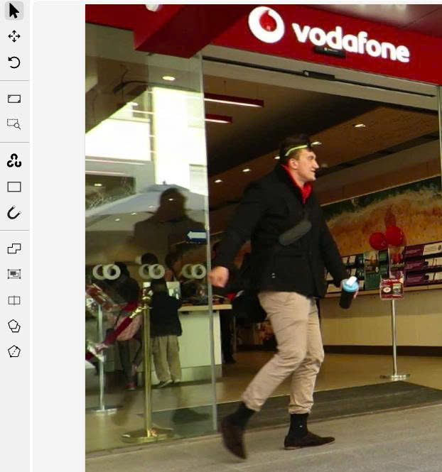

# Báo cáo cá nhân — DinhTruongPhong-2A202603126

Đoạn video: MOT17-09, 150 frame (frame 1–150), nguồn MOTChallenge, giấy phép CC BY-NC-SA 3.0.

## 0. Thông tin học viên

- Họ tên: Đinh Trường Phong
- MSSV: 2A202603126
- Mã đề (A/B/C): A
- Email: 26ai.phongdt@vinuni.edu.vn
- Link repository: https://github.com/kavsir/K5-L2-Day5-DinhTruongPhong-2A202603126-MOTTracking.git
- Giờ bắt đầu: 16:30
- Giờ kết thúc: 17:50

## 1. Xem trước đoạn video (CP0)

Ghi **trước khi vẽ**, mỗi người một dòng.

| Mã | Frame xuất hiện | Frame cuối thấy được | Rẽ / dừng / đổi tốc độ ở frame | Bị che ở frame | Ghi chú |
|---|---|---|---|---|---|
| P1 | 0 | 149 | 34–38, 50–54 | 30–49 | Người áo len đen, đi qua shop Vodafone, bị P2 che khuất hoàn toàn ở frame 39–49 |
| P2 | 0 | 149 | 40, 60 | Không | Nam thanh niên áo khoác đen, quần kaki/be, đi từ trái sang phải che P1 |
| P3 | 0 | 146 | 40, 106 | 110–136 | Người mặc áo sơ mi kẻ, bị che khuất đoạn 110–136 và ra khỏi khung ở frame 146 |
| P4 | 8 | 149 | 38, 78 | 38–48 | Người mặc áo xanh lam, tiến vào khung từ frame 8, bị người ngược chiều che 1 phần |
| P5 | 61 | 149 | 91, 111 | 71–81 | Bé gái áo trắng, tiến vào khung hình từ frame 61, kích thước nhỏ |

## 2. Keyframe và thời gian (CP1, CP4)

Số keyframe lấy từ kết quả `src/check_submission.py`.

| Mã | Số keyframe | Keyframe ở frame | Số frame có mặt | Keyframe / 100 frame | Thời gian (phút) | Chỗ khó |
|---|---|---|---|---|---|---|
| P1 | 21 | [0, 10, 20, 30, 34, 37, 38, 50, 51, 52, 53, 59, 69, 79, 89, 99, 109, 119, 129, 139, 149] | 139 | 15.1 | 15 | Bị P2 che khuất từ f39–f49, phải ước lượng amodal box và bật cờ outside |
| P2 | 17 | [0, 10, 20, 30, 38, 40, 50, 60, 70, 80, 90, 100, 110, 120, 130, 140, 149] | 150 | 11.3 | 12 | Đi ngang qua che P1, bóng đổ dưới chân và phản chiếu qua kính cửa hàng |
| P3 | 13 | [0, 10, 20, 30, 40, 106, 107, 137, 139, 140, 141, 142, 144] | 120 | 10.8 | 10 | Bị che khuất ở frame 110–136 và kết thúc track ở frame 146 |
| P4 | 15 | [8, 18, 28, 38, 48, 58, 68, 78, 88, 98, 108, 118, 128, 138, 148] | 142 | 10.6 | 10 | Xuất hiện từ frame 8 sát mép ảnh, bị che một phần bởi người đi ngược hướng |
| P5 | 9 | [61, 71, 81, 91, 101, 111, 131, 141, 149] | 89 | 10.1 | 8 | Xuất hiện trễ ở frame 61, kích thước nhỏ cần phóng to để căn sát mép chân |
| **Tổng** | **75** | | **640** | **11.7** | **55** | |

Keyframe / 100 frame của cả bài = tổng keyframe ÷ tổng số frame có mặt × 100 = 75 ÷ 640 × 100 = 11.7 keyframe / 100 frame.

Bạn đặt keyframe nhiều nhất ở người nào? Vì sao (người đó rẽ, dừng, lại gần camera hay bị che)?

Đặt keyframe nhiều nhất ở **P1 (21 keyframe)** vì:
- P1 gặp tình huống che khuất phức tạp nhất: bị P2 đi cắt mặt che khuất hoàn toàn (từ frame 39 đến 49).
- Ngay trước khi bị che (frame 34–38) và ngay sau khi tái xuất hiện (frame 50–53), tốc độ quan sát và hướng bước đi có sự biến thiên nên cần tăng mật độ keyframe để đường nội suy không bị cắt góc hoặc trôi hộp (drift).

## 3. Đoạn bị che (CP2)

Người bị che: `P1`

| Mốc | Frame |
|---|---:|
| Bắt đầu bị che một phần (bật `occluded`) | 30 |
| Mất hẳn (bật `outside`) | 39 |
| Hiện lại (tắt `outside`) | 50 |
| Thấy rõ trở lại (tắt `occluded`) | 54 |

- Thời gian khuất hẳn: 11 frame = 11/30 s ≈ 0.37 giây.
- Quyết định: Giữ cùng ID (Track ID 1).
- Lý do (trả lời 3 câu: khuất bao lâu so với 60 frame, ngoại hình có khớp, chỗ hiện lại có đúng hướng và tốc độ):
  1. **Thời gian khuất:** 11 frame (~0.37s), ngắn hơn rất nhiều so với ngưỡng 60 frame (2 giây) quy định của lớp.
  2. **Ngoại hình:** Hoàn toàn trùng khớp (áo len đen, dáng người, kiểu tóc).
  3. **Vị trí và động học:** Vị trí xuất hiện ở frame 50 khớp với vận tốc và hướng di chuyển từ phải qua trái ban đầu của P1.

Ảnh chụp màn hình:





## 4. Tự review ID (CP3)

Lượt 1 theo người (đi ngược từ frame 149 về 0 trên CVAT), lượt 2 theo cảnh (nhảy 10 frame). Ít nhất 3 dòng; không có lỗi thì ghi một dòng "đã kiểm hai lượt, không lỗi".

Loại lỗi dùng đúng một trong 7 mã: `id_switch`, `fragmentation`, `lost`, `merge`, `false_track`, `drift`, `flag`.

| Frame | Mã người | Loại lỗi | Mô tả một câu | Phát hiện ở lượt | Đã sửa? |
|---:|---|---|---|---|---|
| 34 | P1 | `drift` | Box nội suy bị trôi lệch khỏi thân người khi P2 bắt đầu đi tới che | Lượt 1 | Có (thêm keyframe 34, 37) |
| 39 | P1 | `flag` | Chưa bật outside khiến box trôi theo P2 khi P1 đã mất hẳn | Lượt 1 | Có (bật outside frame 39–49) |
| 110 | P3 | `lost` | Box trôi ra khỏi người khi P3 đi vào vùng che khuất | Lượt 2 | Có (bật outside frame 110–136) |

Tổng hợp số lỗi theo loại:

| `id_switch` | `fragmentation` | `lost` | `merge` | `false_track` | `drift` | `flag` |
|---:|---:|---:|---:|---:|---:|---:|
| 0 | 0 | 1 | 0 | 0 | 1 | 1 |

Lỗi nào chỉ lượt 2 (theo cảnh) mới thấy, lượt 1 (theo người) không thấy? Vì sao?

Lỗi `lost` ở P3 hoặc các lỗi tương tác giữa các đối tượng (như `merge` box): Ở lượt 1 (theo người), mắt ta chỉ tập trung vào một đối tượng duy nhất nên dễ bỏ sót bối cảnh xung quanh và không nhận ra đối tượng đã bị vật cản che hoàn toàn hay bị box của đối tượng khác nuốt trọn. Lượt 2 (theo cảnh) cho phép nhìn tổng thể không gian đa đối tượng, dễ dàng phát hiện sự thiếu sót box hoặc chồng chéo giữa các track.

## 5. File xuất và kết quả tự kiểm (CP4)

| Kiểm tra | Kết quả |
|---|---|
| Tên file MOT 1.1 | `DinhTruongPhong_mot.zip` |
| Tên file CVAT for video 1.1 | `DinhTruongPhong_cvat_video.zip` |
| Số track ID khác nhau trong `gt/gt.txt` (phải là 5) | 5 (Đúng) |
| Frame `outside` không có dòng trong `gt.txt` (đúng / sai) | Đúng |
| Job đã completed trên CVAT máy cá nhân | Đúng |

Dán phần tóm tắt in ra từ `src/check_submission.py`:

```text
Số frame in theo CVAT (bắt đầu từ 0). Trong gt.txt, frame_id = frame CVAT + 1.

=== File MOT 1.1: DinhTruongPhong_mot.zip ===
  Số track ID: 5   |   Tổng số box: 640
  [OK]        Đúng 5 track ID.

  Track | Frame có mặt | Số frame | Đoạn vắng (outside)
      1 |   0–149      |      139 | 39–49
      2 |   0–149      |      150 | -
      3 |   0–146      |      120 | 110–136
      4 |   8–149      |      142 | -
      5 |  61–149      |       89 | -


=== File CVAT for video 1.1: DinhTruongPhong_cvat_video.zip ===

  Track | Nhãn   | Frame thấy | Keyframe | KF/100 frame | Frame occluded | Lần bật outside
      0 | person |        139 |       21 |         15.1 |              8 |               1
              Track 0: keyframe ở frame [0, 10, 20, 30, 34, 37, 38, 50, 51, 52, 53, 59, 69, 79, 89, 99, 109, 119, 129, 139, 149]
      1 | person |         89 |        9 |         10.1 |             10 |               0
              Track 1: keyframe ở frame [61, 71, 81, 91, 101, 111, 131, 141, 149]
      2 | person |        150 |       17 |         11.3 |              2 |               0
              Track 2: keyframe ở frame [0, 10, 20, 30, 38, 40, 50, 60, 70, 80, 90, 100, 110, 120, 130, 140, 149]
      3 | person |        142 |       15 |         10.6 |             20 |               0
              Track 3: keyframe ở frame [8, 18, 28, 38, 48, 58, 68, 78, 88, 98, 108, 118, 128, 138, 148]
      4 | person |        120 |       13 |         10.8 |              7 |               2
              Track 4: keyframe ở frame [0, 10, 20, 30, 40, 106, 107, 137, 139, 140, 141, 142, 144]

  Tổng: 75 keyframe / 640 frame có mặt = 11.7 keyframe / 100 frame
  [OK]        Đọc được 5 track từ annotations.xml.

=== Tóm tắt ===
  Lỗi: 0   |   Cảnh báo: 0
  Đạt. Dán phần tóm tắt này vào báo cáo mục 5.
```

## 6. Ba câu kết

1. Nếu được gán lại, bạn sẽ đặt keyframe khác ở đâu? Vì sao?

   Nếu được gán lại, tôi sẽ tối ưu giảm bớt một số keyframe ở các đoạn P2 đi thẳng đều (như đoạn giữa frame 70–100) để tận dụng triệt để đường nội suy tuyến tính, và tập trung đặt thêm 1–2 keyframe ở P4 tại khoảnh khắc người đó bắt đầu xuất hiện sát mép ảnh (frame 8–12) để bounding box ổn định sớm hơn.

2. Có chỗ nào bạn không chắc "cùng ID hay ID mới"? Bạn đã quyết định và ghi chú thế nào?

   Tại đoạn P1 bị che bởi P2 (frame 39–49), ban đầu tôi băn khoăn liệu sau khi khuất hoàn toàn thì người bước ra có đúng là P1 hay không. Sau khi kiểm tra 3 tiêu chí theo Guideline (thời gian khuất chỉ 11 frame < 60 frame, trang phục áo len đen hoàn toàn khớp, hướng đi và vận tốc đồng nhất), tôi quyết định giữ cùng Track ID 1 và chỉ dùng cờ `outside` thay vì tạo track mới.

3. Một lỗi ID trong job của bạn (nếu không còn sót, chọn lỗi đã sửa) có thể làm xe tự lái dự đoán sai chuyển động của người đó như thế nào? Lỗi đó ảnh hưởng MOTA hay IDF1 nhiều hơn?

   Nếu để xảy ra lỗi `id_switch` tại đoạn P1 bị P2 che (ví dụ track của P1 bị dính sang P2 hoặc đứt track tạo ID mới), hệ thống xe tự lái sẽ tính toán vận tốc dựa trên tọa độ box bị nhảy vọt tức thời (vận tốc ảo cực lớn), dẫn đến module dự đoán quỹ đạo (trajectory prediction) bị sai lệch hoàn toàn, có thể gây ra hiện tượng phanh gấp hoặc đánh lái nguy hiểm. Lỗi này ảnh hưởng nghiêm trọng đến **IDF1** nhiều hơn **MOTA**, vì MOTA chỉ trừ điểm tại đúng 1 frame xảy ra nhảy ID, trong khi IDF1 đánh giá khả năng duy trì đúng ID xuyên suốt toàn bộ hành trình của đối tượng.

## Bonus (nếu làm)

### B1 — Hai người đi sát

Chưa thực hiện.

### B2 — So cách đặt keyframe

Chưa thực hiện.

### B3 — So với tracker có sẵn

Chưa thực hiện.

## 7. Tài liệu tham khảo và công cụ AI đã dùng

- MOTChallenge MOT17 Benchmark Dataset (MOT17-09).
- CVAT Community Tool (Track mode & Interpolation).
- AI Assistant hỗ trợ rà soát định dạng và kiểm tra checklist bài nộp.
